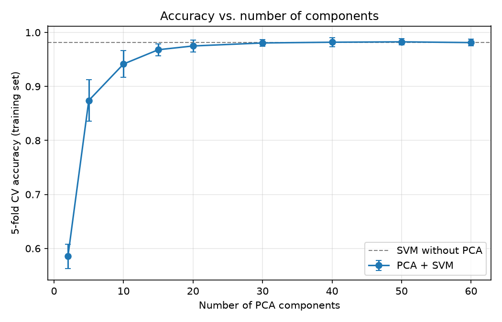
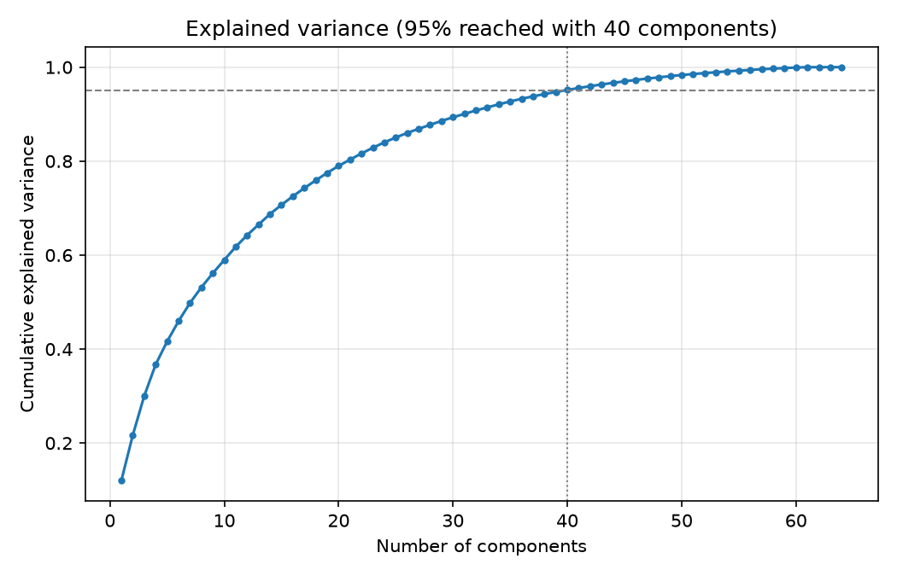
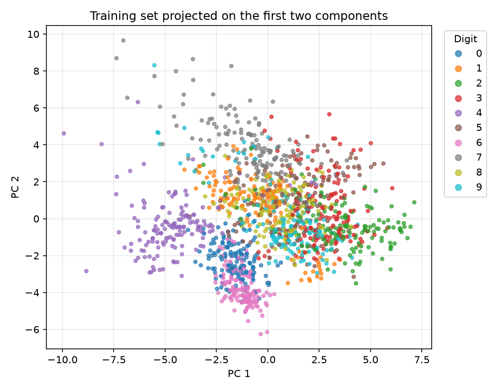
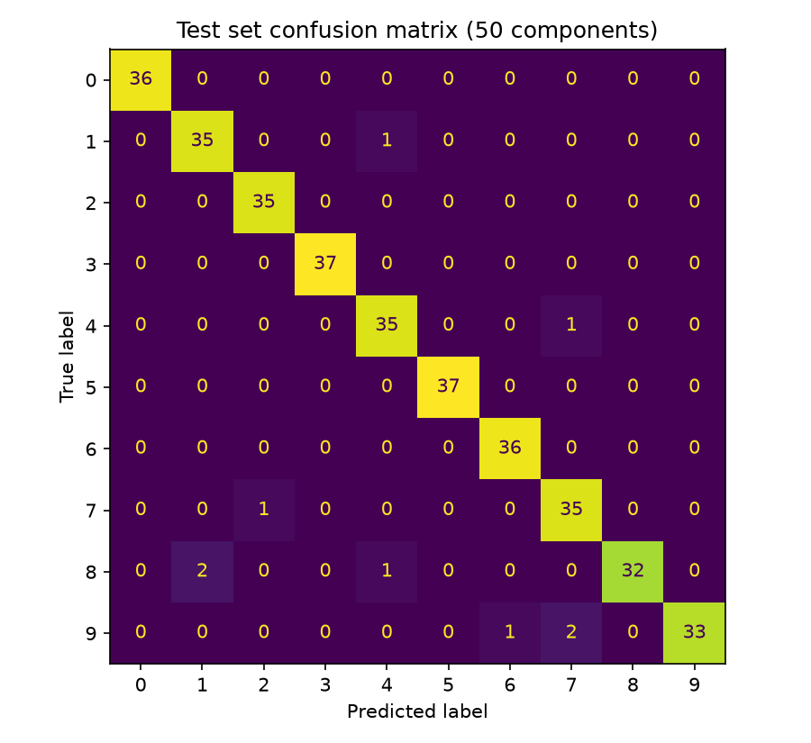

# PCA and SVM on the Digits Dataset

How much can the scikit-learn Digits images be compressed with PCA before an SVM classifier loses accuracy? This project explores the dataset with PCA, selects the number of components by cross-validation, and evaluates the result on a held-out test set.

## Dataset

[Digits](https://scikit-learn.org/stable/datasets/toy_dataset.html#digits-dataset) ships with scikit-learn: 1,797 grayscale images of handwritten digits (0–9), each 8×8 pixels, giving 64 features with values from 0 to 16. There are no missing values. The data is split once into a stratified 80% training set (1,437 images) and 20% test set (360 images) with a fixed random seed.

## Method

1. **Preprocessing.** Every model is a scikit-learn `Pipeline`: `StandardScaler` → `PCA` (optional) → `SVC` with an RBF kernel (`C=1.0`, `gamma="scale"`). Scaling and PCA are fitted inside the pipeline, so cross-validation folds and the test set never leak into them.
2. **Exploration.** Explained variance and a 2-D projection are computed on the standardized training set, i.e. the data the classifier sees.
3. **Model selection.** 5-fold stratified cross-validation on the training set compares 2, 5, 10, 15, 20, 30, 40, 50 and 60 components, plus an SVM without PCA as a baseline. The number of components with the highest mean CV accuracy is selected.
4. **Final evaluation.** The selected model and the 2-component model are fitted on the full training set and evaluated once on the test set. The test set plays no part in any choice.

## Results

Cross-validation accuracy on the training set:

| Components | CV accuracy |
| ---: | :--- |
| 2 | 0.585 ± 0.023 |
| 5 | 0.874 ± 0.038 |
| 10 | 0.942 ± 0.025 |
| 15 | 0.968 ± 0.011 |
| 20 | 0.975 ± 0.011 |
| 30 | 0.981 ± 0.006 |
| 40 | 0.982 ± 0.009 |
| **50** | **0.983 ± 0.006** |
| 60 | 0.981 ± 0.006 |
| no PCA | 0.981 ± 0.006 |

Test set accuracy:

| Model | Test accuracy |
| :--- | ---: |
| PCA, 50 components (selected) | 0.975 |
| PCA, 2 components | 0.542 |



Two components keep about 22% of the variance. Some digits already form recognisable groups (4 and 6 in particular), but most overlap, which is why the 2-component model reaches only 54%. Accuracy rises steeply up to about 15–20 components and then levels off: from 30 components on, the differences are smaller than the spread across folds, and PCA neither helps nor hurts compared with the SVM on all 64 features. Ninety-five percent of the variance is reached with 40 components.

| | |
| :---: | :---: |
|  |  |

On the test set the selected model misclassifies 9 of 360 images; the most frequent confusions are 8 → 1 and 9 → 7.



## Running

Requires Python 3.11 or later (the minimum for current scikit-learn releases).

```bash
git clone https://github.com/laesf/Analysis-PCA-SVM.git
cd Analysis-PCA-SVM
python -m venv .venv
source .venv/bin/activate
pip install -r requirements.txt
python analysis.py
```

The script prints the cross-validation table, the selected number of components, the test results and a classification report, and writes the four figures to `figures/`. It takes a few seconds. Results are deterministic for a given library version; the numbers above were produced with Python 3.14, scikit-learn 1.9.1, NumPy 2.5.5 and Matplotlib 3.11.2.

Tests:

```bash
python -m unittest
```

## Limitations

- SVM hyperparameters are fixed at scikit-learn's defaults; only the number of PCA components is tuned.
- The selection picks the highest mean CV accuracy. Above 30 components the candidates are within one standard deviation of each other, so a smaller model would be an equally defensible choice.
- Results come from a single train/test split of a small, clean dataset.
- The test set was not used to select the model, but its score was seen during development: an earlier run with a grid ending at 40 components printed a test accuracy of 0.978. The grid was then extended to 60 because the best CV score sat at the edge of the grid, not because of the test result.
